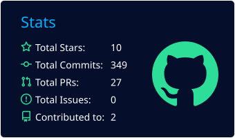
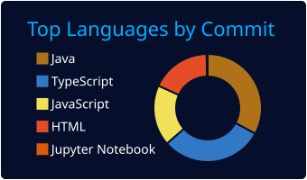

<!--
**MatheusRibeiroS/MatheusRibeiroS** is a ✨ _special_ ✨ repository because its `README.md` (this file) appears on your GitHub profile.

Here are some ideas to get you started:

- 🔭 I’m currently working on ...
- 🌱 I’m currently learning ...
- 👯 I’m looking to collaborate on ...
- 🤔 I’m looking for help with ...
- 💬 Ask me about ...
- 📫 How to reach me: ...
- 😄 Pronouns: ...
- ⚡ Fun fact: ...
-->

    <h1 align="center"> Hi 👋🏾, I'm Matheus Ribeiro </h1>
    <h3 align="center">A programmer with a Bachelor's degree in Computer Science from <a href="https://www.international.unesp.br/"
            target="__blank">UNESP (São Paulo State University)</a>
    </h3>

<h2 align="center"> GitHub Stats </h2>

    
    

<h1 align="center"></h1>

<h3 align="left">Connect with me:</h3>

    
    
    

<h3 align="left">Programming languages:</h3>

    

<h3 align="left">Frameworks & Libraries:</h3>

    

<h3 align="left">Cloud & DevOps:</h3>

    

<h3 align="left">Databases:</h3>

    

<h3 align="left">Version Control:</h3>

    

<h1></h1>

    

        <a href="https://gitlab.com/MatheusRibeiroS">
            
            
gitlab.com/MatheusRibeiroS

        </a>
    

    <h3 align="center">Looking for more recent activity? I've been quite active on my GitLab account, so feel free to
        check it out as well!</h3>
    

        
    

